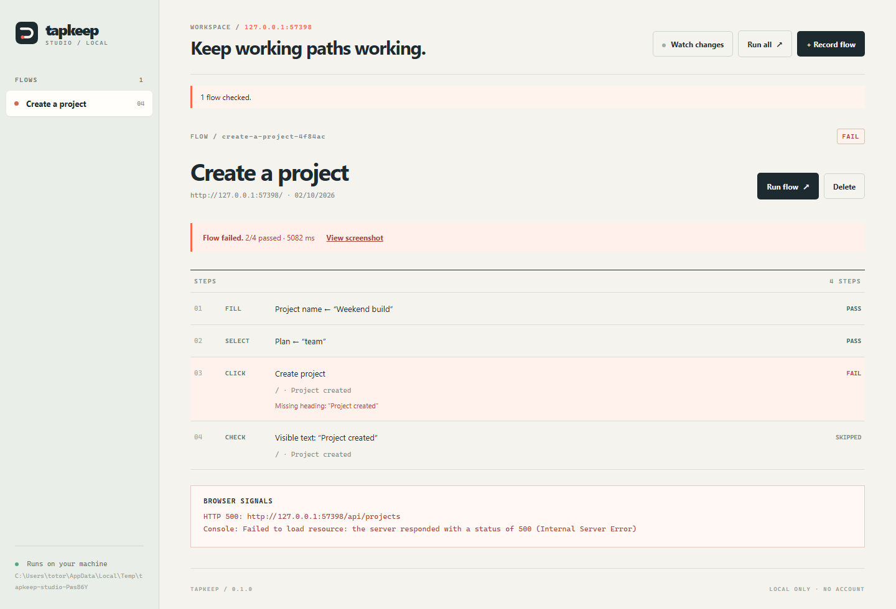

<p align="center"></p>

<h1 align="center">Tapkeep</h1>
<p align="center"><strong>Keep working paths working.</strong></p>
<p align="center">Record a path through your web app. Replay after a change. See the first step that breaks.</p>
<p align="center"><a href="https://github.com/kofudev/tapkeep/actions/workflows/ci.yml"></a> · MIT · Windows / macOS / Linux · Local</p>



You change code. The app still builds. But “Create project” now redirects to login, a heading disappears, or an API returns 500. Tapkeep catches these changes in the paths you recorded, without writing a test suite first.

1. Open Studio and record a real path in the browser.
2. Add a visible text check for the outcome you care about.
3. Replay it manually, on file changes, or in CI.

## Install

Requires **Node.js 22+**. Chromium installs once through Playwright.

Install the packaged GitHub release:

```sh
npm install -g https://github.com/kofudev/tapkeep/releases/download/v0.1.0/tapkeep-0.1.0.tgz
tapkeep setup
```

From source:

```sh
git clone https://github.com/kofudev/tapkeep.git
cd tapkeep
npm install
npx playwright install chromium
npm run build
npm link
```

On Linux, `tapkeep setup --with-deps` also installs required browser libraries. The setup command uses Tapkeep's pinned Playwright version, including after global installation.

Start your app normally. Then run from its project folder:

```sh
tapkeep studio http://127.0.0.1:3000
```

Studio opens in your default browser. Recording opens a separate Chromium window. Use that window to perform the path, then click **Save flow** in Studio.

Try the included working demo:

```sh
npm run demo
```

## What it checks

| Signal           | Behavior                                                               |
| ---------------- | ---------------------------------------------------------------------- |
| Actions          | Replays clicks, text fields, single selects and Enter key submissions  |
| Page checkpoints | Captures settled URL path, query, title and visible `h1`/`h2` headings |
| Text checks      | Waits for the visible text you explicitly added                        |
| Browser          | Reports uncaught JavaScript errors and console errors                  |
| Network          | Reports same-origin HTTP 5xx and failed requests                       |
| Failure          | Stops at the first failed action/checkpoint and saves a screenshot     |

The latest three failure screenshots per flow are retained in `.tapkeep/runs`.

Checkpoints are captured when you pause between actions. Rapid action sequences share their final settled checkpoint. Playwright waits for actionable elements; Tapkeep retries changed page state for 3.5 seconds.

## Use daily

Click **Watch changes** in Studio to replay all flows when project files change. Generated folders such as `node_modules`, `dist`, `.next`, and `.tapkeep` are ignored. Runs stay sequential.

Or use the terminal:

```sh
tapkeep run
tapkeep run create-project-a1b2c3
tapkeep watch
tapkeep list

# Use the same recorded paths on another server.
tapkeep run --url http://127.0.0.1:4173

# Machine-readable results.
tapkeep run --json > results.json

# Keep project data in another folder.
tapkeep studio http://127.0.0.1:3000 --root /path/to/project
```

Exit codes: `0` all flows pass; `1` a flow fails; `2` configuration or startup error. An empty or invalid flow collection fails instead of returning a false green.

`--url` replaces the server origin and preserves each recorded start path and query.

## Store flows in Git

Flows are readable JSON in `.tapkeep/flows`. Commit these files. Add this to your project's `.gitignore`:

```gitignore
.tapkeep/runs/
.env
```

Each flow owns its start URL and recorded steps. Re-record a flow when an intentional change alters its expected behavior. You can also edit its JSON; invalid files are reported before replay.

## Passwords and sensitive inputs

Password fields, and fields named like `token`, `secret`, `api_key`, or `card`, become environment references such as `TAPKEEP_SECRET_1`. The recorder replaces these input values before sending an action to the local server.

Set those variables in your shell or in the target project's `.env` file:

```dotenv
TAPKEEP_SECRET_1=your-test-password
```

Shell values take precedence. Known secret values are redacted from replay errors, and recorded secret fields are masked in failure screenshots. Other typed text, page headings and URLs are saved as recorded. A secret displayed elsewhere by your app can appear in a checkpoint or screenshot. Review flows and screenshots before sharing them.

Secret fields are only filled on the target server origin. A redirect to another origin blocks the fill; cross-origin SSO paths are outside V1's scope.

## CI

Run your app on an accessible URL before starting Tapkeep:

```yaml
- uses: actions/setup-node@v7
  with:
    node-version: 22
- run: npm ci
- run: npm install -g https://github.com/kofudev/tapkeep/releases/download/v0.1.0/tapkeep-0.1.0.tgz
- run: tapkeep setup --with-deps
# Start your application here and wait for it to be ready.
- run: tapkeep run --url http://127.0.0.1:3000
```

Commit `.tapkeep/flows` in the app repository. Start the app and wait for readiness before the last step.

## Scope

Tapkeep checks recorded user paths. It does not prove business correctness or explore unrecorded features. Add a text check for outcomes that URL and headings cannot express.

V1 uses one tab and a 1280×800 Chromium viewport. File uploads, iframes, shadow DOM, drag gestures and multi-tab paths are not recorded. Dynamic headings, titles and query values may need removal from hand-edited checkpoints. Use a test environment: replay really clicks, submits and changes your app's data.

The Studio binds to `127.0.0.1`, requires a random session token for every API call, validates Host/Origin, and has no telemetry or hosted service. Your app and Chromium can still make their normal network requests.

## Develop

```sh
npm install
npx playwright install chromium
npm run dev -- studio http://127.0.0.1:3000
npm test
npm run build
npm run smoke
npm pack --dry-run
```

TypeScript backend, plain browser JavaScript/CSS, Playwright execution. See [CONTRIBUTING.md](CONTRIBUTING.md) and [the concept](docs/concept.md).

## Roadmap

- Inspect and edit individual checkpoints in Studio
- Multiple viewport profiles
- Reusable login/setup paths
- Playwright test export
- Explicit waits for app-specific asynchronous outcomes

## Why another testing tool?

[Playwright codegen](https://playwright.dev/docs/codegen) records actions into test code. [BrowserBash](https://github.com/PramodDutta/browserbash) offers broader browser automation and agent workflows. Tapkeep focuses on a small local loop: record a working path, preserve simple page expectations automatically, replay after edits, and inspect the first divergence. It uses no model, account or test-code generator.

## Contribute

Report a concrete recording or replay failure, with a minimal page when possible. Feature contributions should improve this loop and include a test for changed behavior. See [CONTRIBUTING.md](CONTRIBUTING.md).

MIT © kofudev
Kofu
KOFUDEV
